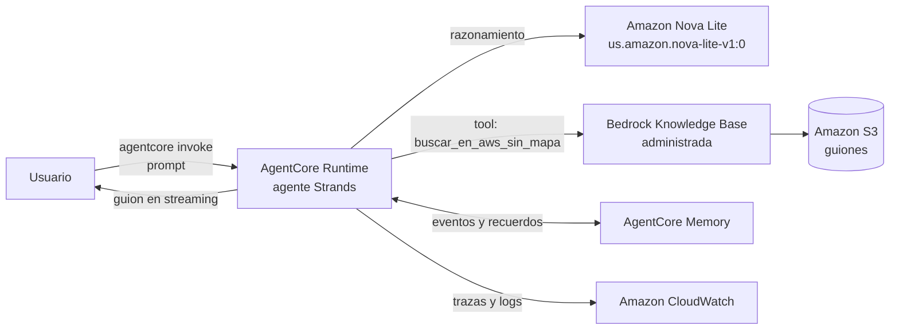

# Guionista: agente en Amazon Bedrock AgentCore con Knowledge Base

Agente de IA que escribe guiones cortos para TikTok usando como fuente los guiones existentes de AWS Sin Mapa. El agente decide cuándo consultar la Knowledge Base, reutiliza los ejemplos encontrados y mantiene memoria entre conversaciones.

Reutiliza la Knowledge Base del proyecto [mi-primer-rag-aws](https://github.com/OshinVillegas/mi-primer-rag-aws).

## Arquitectura



| Componente | Servicio / librería | Función |
|---|---|---|
| Runtime | Amazon Bedrock AgentCore Runtime (build `CodeZip`, Python) | Ejecuta el agente en la nube, sin servidores, cobro por uso |
| Framework | Strands Agents | Bucle del agente: razonamiento, uso de herramientas y streaming |
| Modelo | Amazon Nova Lite (perfil de inferencia `us.`) | Decide qué herramienta usar y redacta el guion |
| Herramienta | `buscar_en_aws_sin_mapa` → `bedrock-agent-runtime.retrieve()` | Recupera fragmentos de los guiones existentes |
| Memoria | AgentCore Memory | Persistencia de la conversación y extracción de recuerdos por usuario |
| Observabilidad | Amazon CloudWatch (Transaction Search) | Trazas OpenTelemetry de cada invocación y llamada a herramientas |

### Decisiones de diseño

- **Agente en lugar de RAG fijo:** el modelo decide cuándo llamar a la herramienta. El *system prompt* le indica buscar siempre antes de escribir.
- **La herramienta reutiliza el `retrieve` del RAG:** misma Knowledge Base, expuesta al agente con el decorador `@tool` de Strands.
- **Amazon Nova Lite:** el modelo por defecto de la plantilla no estaba disponible en la cuenta (`AccessDeniedException`). Nova Lite es de bajo costo y suficiente para la tarea. Se usa el perfil de inferencia entre regiones `us.amazon.nova-lite-v1:0`.
- **Mínimo privilegio:** el rol de ejecución del runtime solo recibe `bedrock:Retrieve` sobre una Knowledge Base concreta.
- **Respuesta honesta ante fallos:** si la herramienta falla o no encuentra nada, el agente debe avisar que el guion no proviene de los guiones de AWS Sin Mapa.

## Estructura del repositorio

```
.
├── agentcore/
│   └── agentcore.json        # Definición del proyecto: runtime y memoria
├── app/agent/
│   ├── main.py               # Entrypoint del runtime, system prompt y herramientas
│   ├── kb_tool.py            # Herramienta buscar_en_aws_sin_mapa
│   ├── model/load.py         # Modelo de Bedrock
│   ├── memory/session.py     # Integración con AgentCore Memory
│   ├── parse.py              # Validación del payload
│   └── pyproject.toml        # Dependencias
├── iam-policy.json           # Política de mínimo privilegio para el rol del runtime
└── pedir_guion.sh            # Cliente de prueba: invoca el agente y limpia la salida
```

Proyecto generado con `agentcore create --template agent-python-strands` y modificado en `main.py`, `kb_tool.py` y `model/load.py`.

## Herramienta: `buscar_en_aws_sin_mapa`

| | |
|---|---|
| Entrada | `tema: str` (por ejemplo, `"grupos IAM"`) |
| Llamada | `retrieve(knowledgeBaseId=KB_ID, retrievalQuery={"text": tema})` |
| Salida | Fragmentos concatenados, cada uno con su fuente (`[Fuente: <uri>]`), o un aviso si no hay resultados |

## Comportamiento del agente (system prompt)

- Rol: Guionista de AWS Sin Mapa.
- Formato: guion de 30 a 60 segundos, en español, con gancho, explicación con ejemplo y cierre.
- Debe usar la herramienta antes de escribir y reutilizar los ejemplos encontrados.
- Si no encuentra información, lo dice y avisa que el guion es general.
- Cierre fijo: *"Aprende AWS desde 0 conmigo y no te pierdas la próxima clase de AWS Sin Mapa."*

## Memoria

Configurada en `agentcore/agentcore.json`: eventos con expiración de 30 días y cuatro estrategias de extracción.

| Estrategia | Namespace |
|---|---|
| `SEMANTIC` | `/users/{actorId}/facts` |
| `USER_PREFERENCE` | `/users/{actorId}/preferences` |
| `SUMMARIZATION` | `/summaries/{actorId}/{sessionId}` |
| `EPISODIC` | `/episodes/{actorId}/{sessionId}` |

## Requisitos

- Cuenta de AWS, región **us-east-1**.
- Una Knowledge Base de Amazon Bedrock con documentos (ver [mi-primer-rag-aws](https://github.com/OshinVillegas/mi-primer-rag-aws)).
- Acceso al modelo Amazon Nova Lite.
- Node.js 20.12+, Python 3.10+ y `uv` (AWS CloudShell cumple con Node y Python).
- Permisos IAM para usar AgentCore y para el bootstrap y despliegue con AWS CDK.

## Despliegue

```bash
# 1. Herramientas
pip3 install uv
sudo npm install -g @aws/agentcore

# 2. Configurar la Knowledge Base
#    Editar app/agent/kb_tool.py y reemplazar TU_KNOWLEDGE_BASE_ID

# 3. Prueba local (puerto 8080)
agentcore dev

# 4. Despliegue en AgentCore Runtime
agentcore deploy
```

**5. Permiso de la herramienta.** El rol de ejecución del runtime no puede leer la Knowledge Base hasta que se le asigne el permiso:

```bash
ROL=$(aws iam list-roles \
  --query "Roles[?contains(RoleName,'Guionista') && contains(RoleName,'Runtime')].RoleName" \
  --output text)

# Reemplazar <ACCOUNT_ID> y <KB_ID> en iam-policy.json antes de ejecutar
aws iam put-role-policy \
  --role-name "$ROL" \
  --policy-name LeerKnowledgeBaseAwsSinMapa \
  --policy-document file://iam-policy.json
```

## Uso

**Local:**

```bash
curl -X POST http://localhost:8080/invocations \
  -H "Content-Type: application/json" \
  -d '{"prompt": "Escribe un guion de TikTok sobre los grupos IAM"}'
```

**En la nube:**

```bash
agentcore invoke --runtime agent \
  --payload '{"prompt": "Escribe un guion de TikTok sobre los grupos IAM"}'

# Salida limpia (sin eventos de streaming ni etiquetas <thinking>)
chmod +x pedir_guion.sh
./pedir_guion.sh los grupos IAM
```

**Payload aceptado:**

| Campo | Tipo | Descripción |
|---|---|---|
| `prompt` | string | Mensaje del usuario |
| `messages` | array | Historial completo; tiene prioridad sobre `prompt` |
| `actorId` | string | Identifica al usuario para la memoria (por defecto `default`) |

La sesión se identifica con la cabecera `X-Amzn-Bedrock-AgentCore-Runtime-Session-Id`.

## Resultados observados

| Prueba | Resultado |
|---|---|
| "Escribe un guion sobre los grupos IAM" | Llama a la herramienta (`Tool #1: buscar_en_aws_sin_mapa`) y reutiliza el ejemplo del guion original (grupo Desarrolladores con María, Pedro, Ana y Juan) |
| "Escribe un guion sobre la responsabilidad compartida" | Usa la distinción "seguridad DE la nube / EN la nube" del guion original |
| Mismo pedido en la nube, antes de asignar el permiso IAM | La herramienta falla; el agente avisa que el guion no proviene de AWS Sin Mapa |
| Métricas de una invocación en la nube | 911 tokens de entrada, 416 de salida, 2,5 s de latencia |

## Costos

- **AgentCore Runtime:** por uso; escala a cero cuando no hay invocaciones.
- **AgentCore Memory:** por eventos y recuerdos almacenados y consultados.
- **Nova Lite:** por tokens.
- **Knowledge Base administrada:** por datos indexados y por búsquedas.
- **CloudWatch:** por logs y trazas ingeridos.

Consultar la [página de precios de Amazon Bedrock](https://aws.amazon.com/bedrock/pricing/) y usar AWS Budgets con alertas.

## Seguridad

- El rol del runtime solo tiene `bedrock:Retrieve` sobre una Knowledge Base (`iam-policy.json`).
- No se versionan archivos con datos de la cuenta: `agentcore/aws-targets.json` y `.env.local` quedan fuera del repositorio.
- La configuración sensible (ID de la Knowledge Base) no está en el código publicado.

## Limitaciones conocidas

- Nova Lite puede incluir su razonamiento en etiquetas `<thinking>` aunque el prompt lo prohíba. `pedir_guion.sh` las elimina en el cliente.
- La memoria puede conservar fallos anteriores: tras corregir el permiso IAM, el agente no volvió a intentar la herramienta en la misma sesión hasta pedírselo de forma explícita. Para pruebas conviene usar una sesión nueva.
- El ID de la Knowledge Base se configura editando `kb_tool.py`.

## Roadmap

- [ ] Infraestructura como código (AWS CDK) para la Knowledge Base y la política IAM del runtime.
- [ ] Pasar `KB_ID` como variable de entorno del runtime.
- [ ] Eliminar las etiquetas `<thinking>` en el servidor, no en el cliente.
- [ ] Evaluación automática de los guiones (uso de la herramienta, estructura y frase de cierre).
- [ ] Guardrails de Amazon Bedrock.

## Limpieza

```bash
agentcore remove all --yes
agentcore deploy --yes
```

Elimina el runtime, la memoria y los recursos creados por el despliegue. La Knowledge Base se elimina desde su propio proyecto.

---

Autora: **Oshin Villegas** · [AWS Sin Mapa](https://www.tiktok.com/@awssinmapa) · serie IA desde 0

*"APRENDE AWS DESDE 0 CONMIGO Y NO TE PIERDAS LA PROXIMA CLASE DE AWS SIN MAPA."*
